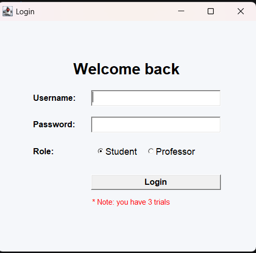
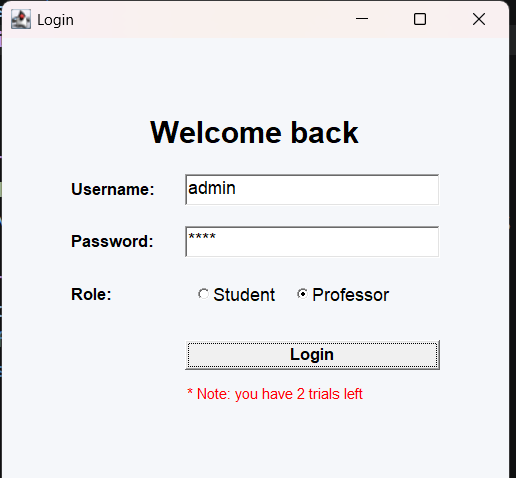
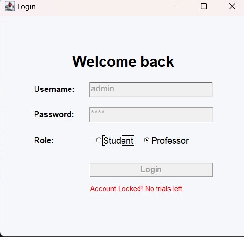
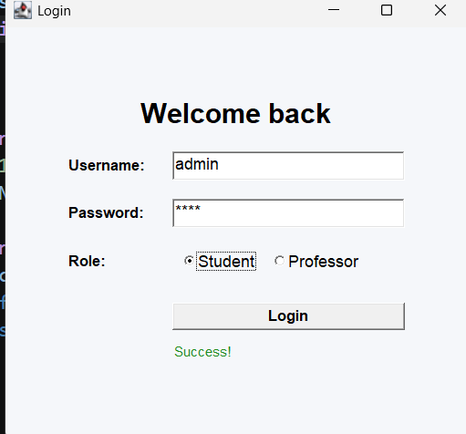
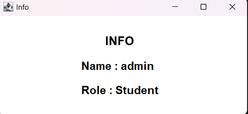

# Java AWT Role-Based Login System

## 📌 Overview
The **Java AWT Role-Based Login System** is a lightweight desktop Graphical User Interface (GUI) application built using Java's Abstract Window Toolkit (`java.awt`). It demonstrates core Object-Oriented Programming (OOP) principles, GUI layout management with `GridBagLayout`, event handling, and a simple authentication mechanism featuring role selection and brute-force protection (maximum of 3 login attempts).

---

## ✨ Features
- **Clean GUI Design:** Built using `java.awt.Frame` and structured neatly with `GridBagLayout`.
- **Role-Based Authentication:** Users must specify their role (`Student` or `Professor`) alongside their username and password.
- **Trial Limit & Account Lockout:** Grants users 3 attempts to log in. Every failed attempt decrements the counter. After 3 failed attempts, the input fields and login button are disabled to lock the account.
- **Password Masking:** Uses `setEchoChar('*')` on the password field for privacy.
- **Dynamic User Dashboard:** Upon successful authentication, a new window (`HomePage`) opens displaying the logged-in user's details.

---

## 📂 Project Structure & Code Explanation

### 1. `User.java` (Data Model)
This class represents the user entity in the system.
- **Fields:** `username`, `password`, and `role` (encapsulated as `private` variables).
- **Constructor:** Initializes a new `User` object with the provided credentials and role.
- **Getters:** Provides public methods (`getUsername()`, `getPassword()`, `getRole()`) to safely access user properties during authentication and dashboard rendering.

### 2. `AuthService.java` (Authentication Logic)
This service class handles user verification using an in-memory data store.
- **Static Data Store:** Uses an `ArrayList<User>` populated via a `static` block with predefined test accounts:
  - `admin` / `1234` (Role: `Student`)
  - `ali` / `pass` (Role: `Editor`)
- **`login(String username, String password, String Role)`:** Iterates through the list of registered users and checks for an exact match of the username, password, and selected role. Returns the `User` object if valid, or `null` if authentication fails.

### 3. `Main.java` (Login GUI & Event Handling)
The entry point of the application that extends `java.awt.Frame`.
- **UI Components:** 
  - `TextField` for username and masked password input.
  - `CheckboxGroup` and `Checkbox` components acting as radio buttons for selecting between `Student` and `Professor`.
  - `Label` (`statusLabel`) to display real-time feedback, remaining trials, or lockout alerts.
  - `Button` (`loginButton`) to trigger authentication.
- **Trial Counter (`Flag = 3`):** Tracks remaining login attempts:
  - **Success:** Turns the status label green (`Success!`) and launches `HomePage`.
  - **Failure:** Decrements `Flag` and updates the warning message. When `Flag` reaches `0`, it displays `"Account Locked! No trials left."` and disables the inputs (`setEnabled(false)`).

### 4. `HomePage.java` (User Info Window)
A secondary GUI window extending `java.awt.Frame` that appears after a successful login.
- **Functionality:** Accepts the authenticated `User` object in its constructor and dynamically renders the user's `Name` and `Role` using bold `SansSerif` labels centered via `GridBagLayout`.

---

## 📸 Application Screenshots & Workflow

### 1. Initial Login Screen
When the application starts, the user is greeted with a clean interface and notified that they have **3 trials**.


### 2. Failed Login Attempt
If the user enters valid credentials (`admin` / `1234`) but selects the wrong role (`Professor` instead of `Student`), authentication fails and the trial counter decreases.


### 3. Account Locked (0 Trials Left)
After 3 consecutive failed attempts, the system locks the account by disabling the text fields and the Login button.


### 4. Successful Login & Info Dashboard
When entering the correct credentials and role (`admin` / `1234` / `Student`), a green `"Success!"` message appears and the **Info** window (`HomePage`) opens displaying the user's details.
<p align="left">
  
  
</p>

---

## 🚀 How to Run the Project

### Prerequisites
- **Java Development Kit (JDK)** (JDK 8 or higher recommended).

### Steps
1. Place all four `.java` files (`Main.java`, `HomePage.java`, `AuthService.java`, `User.java`) in the same directory.
2. Open your terminal or command prompt in that directory.
3. Compile the Java source files:
   ```bash
   javac *.java
   ```
4. Run the application:
   ```bash
   java Main
   ```

---

## 🔑 Default Test Credentials

| Username | Password | Role | Notes |
| :--- | :--- | :--- | :--- |
| `admin` | `1234` | `Student` | Works directly from the UI radio buttons. |
| `ali` | `pass` | `Professor` | Defined in `AuthService.java` 